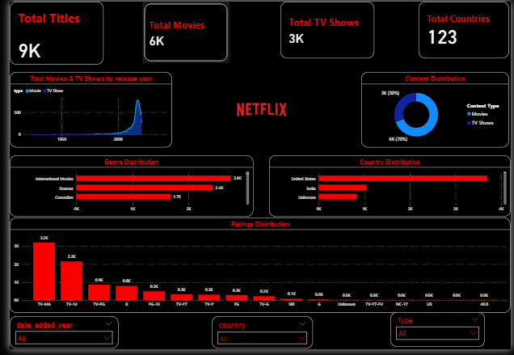

# Netflix Content Analytics Dashboard

## Overview
An interactive data analytics project exploring Netflix's content library using Python and Power BI. The project focuses on understanding the distribution of movies and TV shows, content genres, countries of origin, content ratings, and trends in content additions over time.

## Dashboard Preview



## Dataset
The project uses the Netflix Movies and TV Shows dataset containing **8,807 titles**.

The dataset includes information such as:
- Title
- Content type (Movie or TV Show)
- Director
- Cast
- Country
- Date added to Netflix
- Release year
- Content rating
- Duration
- Genres
- Description

## Tools & Technologies
- Python
- Pandas
- Jupyter Notebook
- Power BI
- DAX

## Data Preparation
Data cleaning and preprocessing were performed using Python and Pandas.

Key steps:
- Checked for duplicate records
- Handled missing values
- Corrected inconsistencies in the rating column
- Converted date-added values into datetime format
- Extracted year and month from date-added information
- Extracted numerical duration values
- Separated movie durations (minutes) and TV show durations (seasons)
- Created separate datasets for genres and countries
- Split multi-valued genre and country columns into individual records for analysis

## Dashboard Features

### Key Performance Indicators
- Total Titles
- Total Movies
- Total TV Shows
- Countries Represented

### Visualizations
- Titles Added Over Time
- Movies vs TV Shows Distribution
- Top 10 Genres
- Top 10 Countries
- Content Ratings Distribution

### Interactive Filters
- Content Type
- Year Added
- Country
- Content Rating

## Project Structure

```text
Netflix-Content-Analytics/
│
├── README.md
├── Netflix_Content_Analytics.pbix
│
├── Dataset/
│   ├── netflix_titles.csv
│   ├── netflix_main.csv
│   ├── netflix_genres.csv
│   └── netflix_countries.csv
│
├── Python/
│   └── Netflix_Data_Cleaning.ipynb
│
└── Images/
    └── dashboard.png
```

## Key Objectives
- Analyze the composition of Netflix's content library
- Compare movies and TV shows
- Identify the most common genres
- Explore the geographical distribution of content
- Understand content rating distribution
- Examine trends in content additions over time

## Conclusion
This project demonstrates an end-to-end data analytics workflow, from data cleaning and transformation using Python to interactive dashboard development using Power BI. It highlights the use of data preparation, visualization, and exploratory analysis to derive insights from a real-world dataset.
